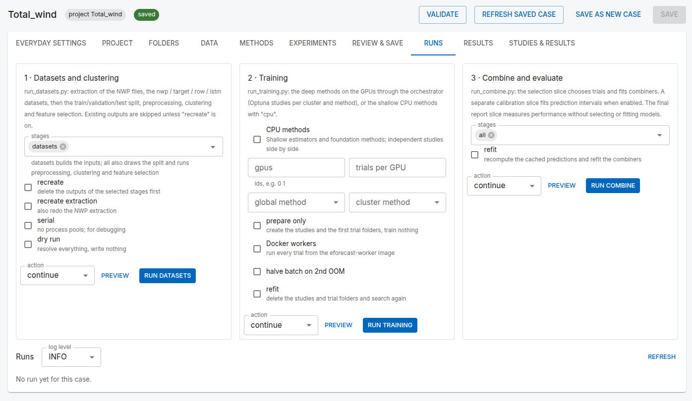
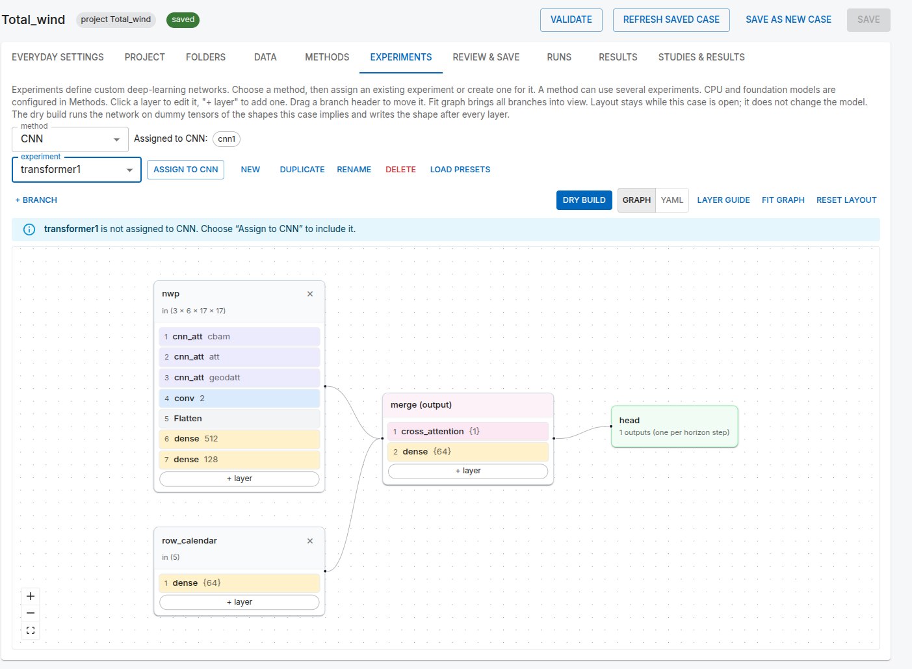
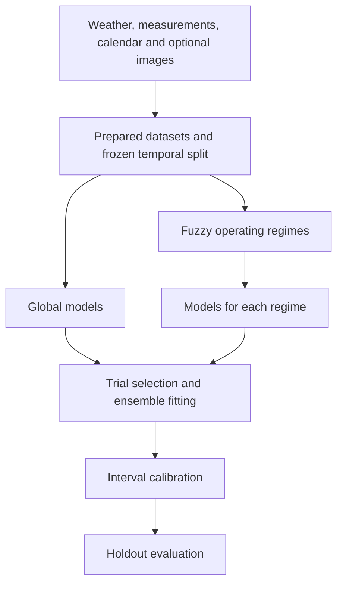
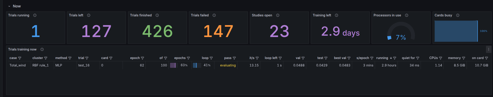
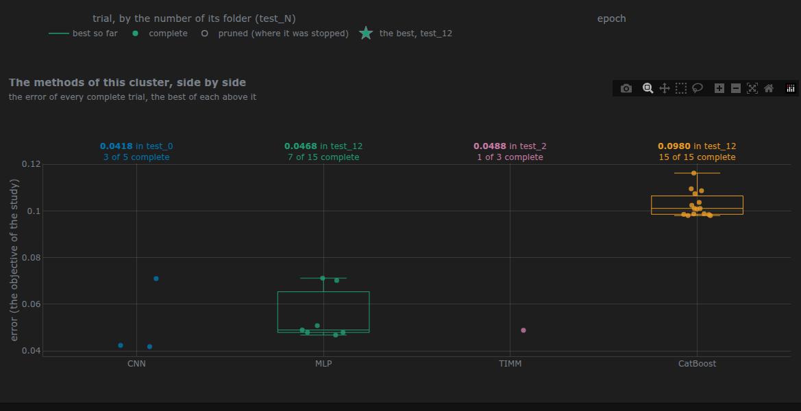

# eForecast

## A configurable machine-learning pipeline for energy forecasting

eForecast brings data preparation, model development, training, ensemble evaluation and monitoring into one workflow. It focuses on wind and solar power forecasting, combining weather forecasts, historical measurements, calendar variables and optional satellite inputs.

The application is designed for researchers and forecasting teams who want to compare ML methods and AI architectures, inspect how experiments behave, and keep the relationship between configuration, data and results clear.

Some capabilities remain private

**Maintainer:** [George Sideratos](https://github.com/joesider9)

[Configuration example](#run-a-configuration-validation-example) · [Design decisions](#engineering-decisions) · [Verification](#verification-and-evaluation) · [Documentation](#documentation) · [AI assistance](#development-and-ai-assistance)



*The Runs view brings dataset preparation, training, and model combination into the same interface.*

## What the application supports

| Area | Capabilities |
| --- | --- |
| Forecast configuration | Define the target, forecast horizon, location, time resolution, input variables and lags. |
| Input preparation | Process numerical weather predictions, historical observations, calendar features and optional image inputs; prepare row features, sequences and weather tensors. |
| Model development | Configure classical ML methods, neural networks and supported time-series foundation models; use global models and models specialised for fuzzy operating regimes. |
| Visual architecture editing | Build networks from input branches, layers, merge operations and forecast heads; inspect tensor shapes with a dry build before training. |
| Experiment execution | Organise Optuna studies by method and scope; run CPU studies and deep-model GPU trials with pruning, continuation and GPU placement informed by measurements. |
| Ensemble evaluation | Select trials, fit combiners, calibrate prediction intervals and report performance on a later holdout period. |
| Observability | Inspect trial histories, learning curves and method comparisons; monitor training, GPUs, processes and containers through the monitoring stack. |

Available families include Random Forest, CatBoost, LightGBM, lasso and RBF methods; CNN, MLP, LSTM and transformer architectures; and adapters for models such as Chronos-2, TimesFM and TiRex. Availability depends on the chosen scope, inputs and installed runtime. See the [model documentation](docs/deep_models.md) and [CPU training scopes](docs/cpu_training_scopes.md).

## Visual model development



*The experiment editor represents a network as branches, layers and connections. The screenshot shows an architecture being edited; assigning it to a method is a separate step.*

An experiment can use different encoders for weather grids, historical sequences, calendar features or images. Their representations are combined before the forecast head. Parameters can be fixed or exposed to the search space. The graph and YAML views describe the same experiment.

## How the workflow fits together



The diagram describes the modelling workflow. The [workflow guide](docs/how_it_works.md) explains the stages, saved artifacts and execution services in more detail.

## Engineering decisions

### Use consistent temporal partitions

Data preparation freezes the temporal partition before fitting preprocessing steps. Scalers are fitted on training rows and reused by the cluster-specific datasets. Target-window overlap is removed at partition boundaries so that a forecast window does not cross into a later evaluation slice.

This makes the data available to each stage explicit and supports meaningful comparisons between model configurations. See [data preparation and workflow](docs/how_it_works.md).

### Combine specialised and global models

A fuzzy RBF model assigns samples to operating regimes. Models can specialise within those regimes while global models use the complete training dataset. Ensemble evaluation includes a mean baseline so that added complexity can be assessed against a simple alternative.

The benefit of clustering or a more complex combiner must be established for the particular dataset and forecast horizon. See [combination and evaluation](docs/combine_evaluation.md).

### Describe neural architectures as configuration

Input branches, encoders and merge operations are represented declaratively. This connects the visual editor to the model builder and makes architecture variants available to the experiment search. Dry builds exercise the configured network on dummy inputs and expose tensor shapes before a longer training run.

See [deep models](docs/deep_models.md).

### Reuse work only when it remains compatible

Run records, configuration snapshots and compatibility checks connect saved outputs to the work that produced them. A file's existence alone is not treated as proof that the stage is complete and reusable. This supports continuation while making the consequences of configuration changes visible.

See [workflow and saved artifacts](docs/how_it_works.md).

### Separate model selection, interval calibration and reporting

The evaluation period is divided chronologically into selection, calibration and holdout slices. Trial selection and ensemble fitting use selection data; interval fitting uses calibration data; final reporting uses the holdout. Overlapping target windows are purged at the boundaries.

A legacy option, `calibration_fraction: 0`, reuses the selection slice for calibration. Keep that distinction explicit when comparing older and newer cases. See the [evaluation protocol](docs/combine_evaluation.md#protocol).

## Run a configuration validation example

This example uses the application's real `ExperimentConfig` model. It validates a small wind configuration, then demonstrates rejection of an invalid CPU setting. It requires no GPU, private dataset or weather download.

**Scope:** this is a runnable configuration example. It does not load data, train a model or generate forecasts. The filename and folders below are configuration values only; they are not read or created. The public snapshot does not yet include a complete data-to-forecast example with redistributable data.

### 1. Create a small, separate environment

The example was checked with Python 3.12.14, Pydantic 2.13.4 and PyYAML 6.0.3. Use Python 3.12 for this example.

```bash
git clone https://github.com/joesider9/eForecast_pipeleine.git
cd eForecast_pipeleine

python3.12 -m venv .venv-config
source .venv-config/bin/activate
python -m pip install "pydantic==2.13.4" "PyYAML==6.0.3"
```

If the repository is private, clone it using a GitHub account with access. The commands above use a POSIX shell; Windows users can use WSL or the equivalent PowerShell environment activation command.

### 2. Run the example from the repository root

```bash
python - <<'PY'
from copy import deepcopy
from pathlib import Path

from pydantic import ValidationError
from eforecast.config.schema import ExperimentConfig

root = Path.cwd()
case = {
    "project": {
        "name": "synthetic_wind_config",
        "group": "Examples",
        "owner": "local",
        "version_model": 1,
        "version_group": 1,
        "horizon_type": "short_term",
        "horizon": 1,
        "coordinates": [38.0, 23.0],
        "area_group": [[37.0, 22.0, 39.0, 24.0]],
        "type": "wind",
        "filename": "synthetic_power.csv",
        "ts_resolution": "H",
        "is_global": True,
        "is_fuzzy": False,
    },
    "folders": {
        "pycharm_path": str(root),
        "sys_folder": str(root / "demo-models"),
        "nwp_folder": str(root / "demo-nwp"),
        "check_exists": False,
    },
    "jobs": {"n_cpus": 1, "n_jobs": 1, "n_gpus": 0},
    "data": {
        "remove_night_hours": False,
        "variables": [
            {"name": "hour", "type": "calendar", "source": "index", "lags": 0}
        ],
        "target_variable": {
            "name": "Generation", "source": "Generation", "columns": ["Step_0"]
        },
    },
    "methods": {
        "backend": "TORCH",
        "cpu_scope": "global",
        "global_methods": {"RF": True},
        "method_params": {"RF": {"n_trials": 1, "n_jobs": 1}},
        "combine_methods": ["mean"],
    },
}

validated = ExperimentConfig.model_validate(case)
print(
    f"Validated {validated.project.name}; "
    f"CPU count={validated.jobs.n_cpus}; GPU count={validated.jobs.n_gpus}"
)

invalid = deepcopy(case)
invalid["jobs"]["n_cpus"] = 0
try:
    ExperimentConfig.model_validate(invalid)
except ValidationError as error:
    print("Invalid resource setting correctly rejected:", error.errors()[0]["loc"])
else:
    raise AssertionError("The invalid configuration was not rejected")

print("No data was loaded and no model was trained.")
PY
```

Expected output:

```text
Validated synthetic_wind_config; CPU count=1; GPU count=0
Invalid resource setting correctly rejected: ('jobs', 'n_cpus')
No data was loaded and no model was trained.
```

## Running a forecasting case

Full execution needs the [workstation installation](docs/installation.md), the data declared by the case, and the runtimes required by its enabled methods. The small environment above is only for configuration validation.

For an already configured installation, the principal stages are:

```bash
# Replace this with a real case that points to your available inputs.
export EFORECAST_CASE=/absolute/path/to/your/case.yaml

# Inspect the dataset stage before executing it.
python run_datasets.py --config "$EFORECAST_CASE" --dry-run
python run_datasets.py --config "$EFORECAST_CASE" --stage all

# Run the enabled CPU methods. Deep GPU training is a separate invocation.
python run_training.py --config "$EFORECAST_CASE" --cpu
# python run_training.py --config "$EFORECAST_CASE"

# Select trials, fit the ensemble, calibrate enabled intervals and evaluate.
python run_combine.py --config "$EFORECAST_CASE"
```

For the interface, build `webui/` and start the backend in a fully installed development environment:

```bash
cd webui
npm ci
npm run build
cd ..

export EFORECAST_WORKSPACE="$PWD/.local-eforecast-workspace"
python -m eforecast.config.serve --host 127.0.0.1 --no-auth
```

Open `http://127.0.0.1:8000`. The `--no-auth` option is for local development. An authenticated shared installation uses the setup in the [administrator guide](docs/administrator.md).

The current public upload has deployment omissions listed under [current limitations](#current-limitations). In particular, the documented online package and Docker worker build require files that are not included in this snapshot.

## Monitoring and comparison



*Follow study progress, active trials and resource use during a training campaign.*



*Compare completed-trial objective values across model families within one cluster. These screenshot values are study objectives, not a benchmark of overall forecasting accuracy.*

## Verification and evaluation

### Checks verified for this public snapshot

The following checks were run against the relevant source files from commit [`c217e9a`](https://github.com/joesider9/eForecast_pipeleine/commit/c217e9a4478390ffbb3485142de6014c0f3eb7cb), published on 25 November 2026.

| Check | Observed result | What it establishes |
| --- | --- | --- |
| Configuration example above | Valid case accepted; invalid CPU count rejected | The example exercises the real configuration model and a resource constraint. |
| `python -m eforecast.config.schema_export --check` | `schema files are current` | Committed case schemas match the generated configuration schema. |
| `python -m eforecast.config.resource_export --check` | `resource schema current` | The committed resource schema matches its Python definition. |
| `node webui/scripts/resource-contract.mjs --check` | `resource TypeScript contract current` | The frontend resource contract matches the committed resource schema. |

These are targeted configuration and contract checks. They do not establish that a full training run, deployment or forecasting benchmark has passed.

### Frontend checks included in the repository

The repository includes Vitest component tests and Playwright browser tests. From `webui/`:

```bash
npm ci
npm test
npm run lint:baseline
npm run build
npm run contracts:check
npx playwright install chromium
npm run test:e2e
```

Node.js and npm are required. Browser tests use the production build, a browser and port 5175. Their HTTP fixtures test interface behaviour; they do not execute a real forecasting workflow. The lint baseline is a recorded allowance, not a claim of zero unrestricted lint findings. See [frontend development and tests](webui/README.md).

These commands are provided for reproduction. The full frontend suite and native dependency installation were not rerun as part of the targeted checks above.

### How to assess forecasting results

Use the holdout reports for forecasting comparisons. Record the dataset, date ranges, forecast horizon, target units or normalisation, baseline, case configuration and source version alongside any published result.

The evaluation outputs include error metrics, timestamp coverage and prediction-interval diagnostics. Check interval coverage by horizon and operating conditions; seasonal time-series dependence means that nominal conformal coverage should not be presented as a universal guarantee. See [evaluation and uncertainty](docs/combine_evaluation.md).

## Current limitations

- **Public release completeness:** the reviewed snapshot does not include `eforecast_online/`, the top-level backend `tests/` suite, GitHub Actions workflows, or the synthetic worker smoke files referenced by parts of the documentation. Frontend tests are included. The worker Dockerfile currently copies the absent online package, so that build requires the missing component before it can complete.
- **Data and complete demonstrations:** case-specific data, trained model artifacts and a complete redistributable forecasting case are not supplied with this README. The configuration example is deliberately independent of them.
- **Environment requirements:** the full native requirements describe a substantial workstation environment. Compatibility depends on the selected methods, Python environment and, for GPU execution, the CUDA stack. A successful configuration check does not qualify that entire environment.
- **Resource scheduling:** measured GPU placement applies to deep-model trials. General compute workers do not reserve CPU, RAM and disk capacity before accepting every task.
- **Cross-site graph workflow:** graph training is a separate CLI workflow. The documented model expects its trained set of sites at inference; it is not automatically a model for an arbitrary new collection of plants.
- **Performance evidence:** screenshots illustrate application behaviour and individual studies. They do not establish a general accuracy improvement, a speedup, or production readiness.

## Development and AI assistance

I lead the development of eForecast and use Claude as a development assistant. The web interface was built with Claude under my guidance, and AI assistance forms part of the development workflow.

Design, review, validation and release decisions remain the responsibility of the project maintainer. The documentation and reproducible checks describe the implementation and the evidence available for assessing it.

For a technical walkthrough, useful starting points are the temporal evaluation protocol, the global and regime-specific models, the declarative network builder, and the management of training trials and reusable artifacts.

## Repository layout

| Path | Purpose |
| --- | --- |
| `eforecast/config/` | Typed case configuration, validation, API and execution coordination |
| `eforecast/datasets/` | Dataset construction, preprocessing and temporal partitioning |
| `eforecast/clustering/` | Fuzzy regime modelling |
| `eforecast/deep_models/` | Neural network builders, layers and training implementations |
| `eforecast/shallow_models/` | Classical ML methods and foundation-model adapters |
| `eforecast/training/` | CPU training, Optuna studies and GPU trial orchestration |
| `eforecast/combine_predictions/` | Prediction selection, combination, interval calibration and evaluation |
| `run_datasets.py`, `run_training.py`, `run_combine.py` | Main modelling stages |
| `run_site_graph.py` | Separate cross-site graph workflow |
| `configuration/` | Experiment templates; live cases belong to the configured workspace |
| `webui/` | React and TypeScript interface and frontend tests |
| `schema/` | Generated configuration and resource schemas |
| `docker/`, `deploy/` | Worker, monitoring and deployment definitions; see release limitations above |
| `docs/` | User, technical and administration guides |

## Documentation

| Guide | Start here when you want to… |
| --- | --- |
| [Documentation index](docs/README.md) | Find the appropriate guide |
| [How it works](docs/how_it_works.md) | Understand the complete workflow and saved artifacts |
| [User guide](docs/user.md) | Configure a case and read results |
| [Command reference](docs/cli.md) | Inspect available commands and settings |
| [Installation](docs/installation.md) | Prepare a forecasting workstation |
| [Troubleshooting](docs/troubleshooting.md) | Investigate a failed or incomplete stage |
| [Deep models](docs/deep_models.md) | Understand branches, layers, fusion and graph models |
| [GPU training and Optuna](docs/gpu_training_optuna.md) | Understand studies, trials and GPU execution |
| [Combination and evaluation](docs/combine_evaluation.md) | Understand selection, uncertainty and holdout reporting |
| [Compute workers](docs/compute_workers.md) | Understand execution routing and resource limits |
| [Administration](docs/administrator.md) | Understand services, model approval and operational procedures |

Some guides describe the broader development installation. Check the public release limitations above before following instructions for components that are not distributed here.

## License

See [LICENSE](LICENSE) and applicable per-file notices for the terms distributed with this version. This README does not replace or amend those terms. Third-party code, dependencies, model weights and datasets remain subject to their respective licences and permissions.

## Contact

For a technical discussion or demonstration, contact [George Sideratos](https://github.com/joesider9).
